<br>

I wanted F1 on my phone and desktop the way the TV graphics show it, without opening an app. So: APEX.
Ten widgets for iOS, Android and Windows, and the small FastAPI server that feeds them live timing.

Before a session the widget counts down. When the lights go out it switches to live timing on its own, then to
results, then to the next session. No refresh, no tapping.


## The widgets

<table>
<tr>
<td align="center" width="20%">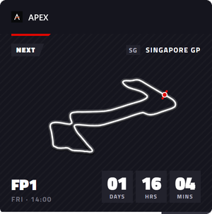<br><sub><b>Race Mode</b><br>whatever is happening now</sub></td>
<td align="center" width="20%">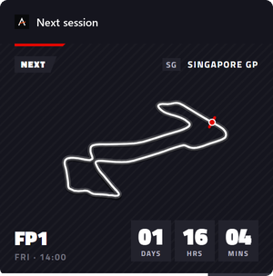<br><sub><b>Next session</b></sub></td>
<td align="center" width="20%">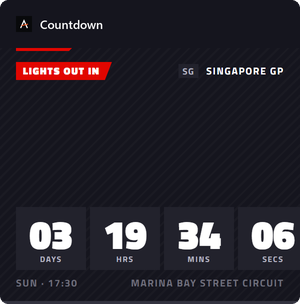<br><sub><b>Countdown</b><br>to lights out</sub></td>
<td align="center" width="20%">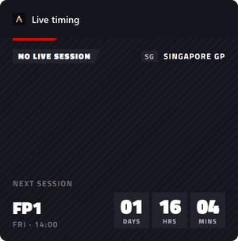<br><sub><b>Live timing</b></sub></td>
<td align="center" width="20%">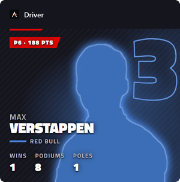<br><sub><b>Driver</b><br>season so far</sub></td>
</tr>
<tr>
<td align="center">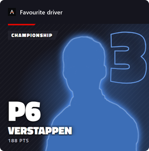<br><sub><b>Favourite driver</b><br>live position, result or grid slot</sub></td>
<td align="center">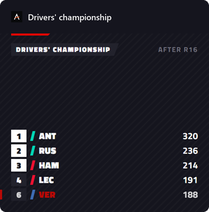<br><sub><b>Drivers' title</b></sub></td>
<td align="center">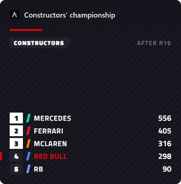<br><sub><b>Constructors' title</b></sub></td>
<td align="center">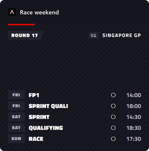<br><sub><b>Race weekend</b><br>every session</sub></td>
<td align="center">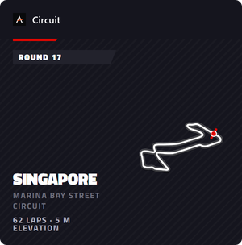<br><sub><b>Circuit</b><br>next track, in 3D</sub></td>
</tr>
</table>

These are real renders. Every widget comes in small, medium and large, in dark, AMOLED and light.

### Live timing

Gaps, pit stops, fastest laps and overtakes from [OpenF1](https://openf1.org) while a session is on. Your driver is
highlighted, and if they're further down than the widget has room for, they take the last row.

<div align="center"></div>

### The tracks are real

The circuit maps aren't drawings. Each one is a real lap from an earlier race at that track (OpenF1 x / y / z),
with elevation, so you can see the climb up to turn 1 at COTA.



## Install

### Windows (desktop, Widgets board, lock screen)

Turn on **Developer Mode** (Settings → System → Advanced), then:

```powershell
powershell -ExecutionPolicy Bypass -File windows\install.ps1
```

That builds the app, registers the widgets and starts the data server, now and at every logon (it runs hidden and
logs to `backend/apex.log`). No .NET SDK on your `PATH`? Pass `-Dotnet <path to dotnet.exe>`; the app targets .NET 10.
Re-run it after pulling. It installs as a package update, so widgets you've pinned stay where they are.

Where they show up:

- **Desktop:** frameless widgets down the right edge. Drag to move, right-click to resize or remove. Add more from the
  APEX app in the Start menu.
- **Widgets board:** <kbd>Win</kbd> + <kbd>W</kbd> → **+** → APEX. **Customize** in a widget's menu sets the driver and density.
- **Lock screen:** Settings → Personalization → Lock screen → Widgets. Windows only allows the small size there, so
  each widget has a wide layout built for that tile.

The board and lock screen can't run web pages, so they show a picture of the desktop widget. An offscreen WebView2
retakes it when the data changes, at most once a minute. If the server is down they fall back to plain text cards.

<details>
<summary>Debugging without the board</summary>
<br>

- `APEX.exe -DumpImages <dir> [driver]` writes the picture every widget would show, at every size.
- `APEX.exe -DumpCards <dir> [driver]` writes the text-card fallback (template and data).
- To refresh the **Add widgets** previews after a design change: `APEX.exe -DumpImages <dir> max_verstappen`, then
  `backend\.venv\Scripts\python windows\screenshots.py <dir>`, then re-run the install script.
- WinUI crashes go to `%LOCALAPPDATA%\APEX\crash.log`.

</details>

### Android (Jetpack Glance)

```sh
cd android
./gradlew assembleDebug -PapexBaseUrl=https://your-backend   # defaults to http://10.0.2.2:8077 (emulator → host)
```

Needs the Android SDK (compileSdk 37) and JDK 17+. Open the app to pick a driver and a style, then use **Add to home
screen** or the launcher's widget picker.

### iOS (WidgetKit, Live Activity, Dynamic Island)

```sh
cd ios
brew install xcodegen && xcodegen      # → APEX.xcodeproj
```

Set your team in `project.yml`, register the App Group `group.club.apex` and set `APEX_BASE_URL`. I haven't built
this one yet, so expect to fix a thing or two.


## Backend

```sh
cd backend
python -m venv .venv && .venv/Scripts/pip install -r requirements.txt   # .venv/bin on macOS/Linux
.venv/Scripts/python -m uvicorn apex.main:app --port 8077
.venv/Scripts/python -m pytest -q
```

**http://localhost:8077** shows every widget at every size with live data, and can fake the situations that are
hard to wait for: lights out, a live race, live qualifying, results, offline, live data unavailable, loading.

It pulls the schedule, standings and results from [Jolpica](https://github.com/jolpica/jolpica-f1) and live timing from
OpenF1, and hands each widget everything it needs in one request (`GET /api/widgets/snapshot`). Widgets work out
for themselves when a session starts, so they flip to live on time even if the last refresh was an hour ago. If the
network drops, they keep showing the last data with a "last updated" note instead of going blank.

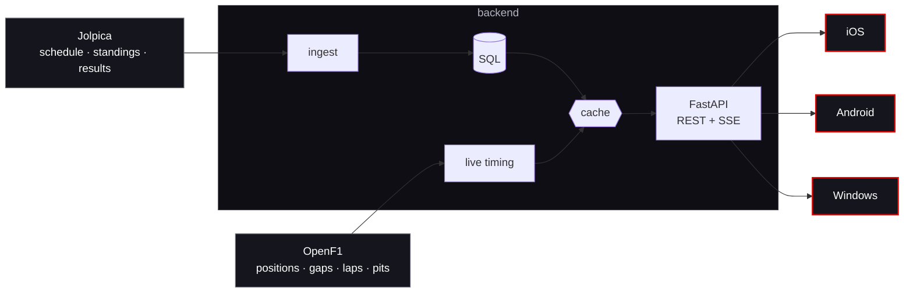

<details>
<summary>Environment variables</summary>
<br>

All optional (see `backend/.env.example`). With none set it runs on SQLite with an in-memory cache.

| Variable | What it does |
|---|---|
| `DATABASE_URL` | `postgresql+psycopg://…` in production |
| `REDIS_URL` | shared cache when running several workers |
| `OPENF1_TOKEN` | paid OpenF1 key. You need it for real-time timing during sessions; historical data is free |
| `API_KEY` | when set, every `/api` call needs an `X-API-Key` header |
| `EXTRA_SEASONS` | e.g. `2025`, for past seasons in the Driver widget |
| `BACKGROUND_JOBS` | set to `0` on all but one replica, so only one process polls Jolpica and OpenF1 |

Behind a reverse proxy, start uvicorn with `--forwarded-allow-ips=<proxy ip>` so rate limiting sees real client IPs.
After schema changes, regenerate the API contract:

```sh
python -c "import json; from apex.main import app; json.dump(app.openapi(), open('../shared/api-schema/openapi.json','w'), indent=1)"
```

</details>

## What's where

| | |
|---|---|
| `windows/` | Widgets board provider (COM, Adaptive Cards), desktop widgets and the WinUI app. Builds. |
| `android/` | Kotlin, Jetpack Glance, WorkManager. Builds, lint clean. |
| `ios/` | SwiftUI, WidgetKit, App Intents, Live Activity. Source only so far; needs Xcode. |
| `backend/` | FastAPI, SQLAlchemy, Redis or in-memory cache, and the web preview. Tests pass. |
| `shared/` | Design tokens, logo, OpenAPI schema. |
| `docs/` | [Architecture](docs/ARCHITECTURE.md) and the [design system](docs/DESIGN_SYSTEM.md). |

<br>
<p align="center"></p>
